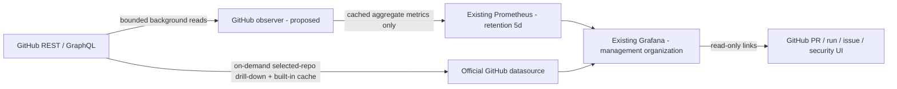

# GitHub organization management in Grafana

Status: **native dashboard pack implemented; VM installation required**. The broader observer design below remains proposed. Scope:
Big-Data-Club. Owner: engineering management / DevOps. Retention: **5 days**,
following the requested limit and existing Prometheus configuration.

[Open the interactive dashboard preview](../design/github-management-preview.html).
Every number in that preview is synthetic; repository names come from this
workspace. It makes no API requests and contains no credentials.

## Existing system and intended boundary

The active kube-prometheus-stack values are
[`k3s/kube-prometheus-stack/values.yaml`](../../k3s/kube-prometheus-stack/values.yaml).
Grafana serves `/monitor/`; dashboard discovery uses `grafana_dashboard=1` in
`monitoring`. Prometheus retains 5d / at most 3 GiB. Keep these limits. Do not
install another Grafana or extend retention for this feature.

This is a read-only management surface. Links open GitHub to review a PR, inspect
a failed workflow, manage access, or investigate a security alert. Re-running
workflows, merging PRs and editing permissions are not dashboard actions.

A current snapshot and a historical series are different: an open PR created
40 days ago must still appear in today's backlog, even though metric history
is retained for only five days. Do not infer five-day history before collection
started. Show the coverage start timestamp and gray out unavailable periods.

## Seven linked dashboards

Filters: organization (fixed by credential scope), repository (multi-select),
team only when an authoritative mapping exists, visibility, workflow, environment
and time range. Default 24h; quick ranges 1h / 24h / 5d. Never offer a misleading
30/90-day range on a five-day source. Preserve filters when following drill-downs.
Exclude archived repositories from operational KPIs by default, but include them
in the inventory and coverage denominator with a separate archived count.

| Dashboard | Management question | Main panels | Drill-down |
|---|---|---|---|
| 01 Organization overview | What needs attention now? | Covered / expected repos; CI success + sample size; open PRs awaiting first review; high/critical security exposure when available; rolling CI trend; PR flow; prioritized blockers | The six domain dashboards and GitHub |
| 02 CI/CD and releases | What is blocking delivery? | Run conclusions; queued/running/waiting approval; queue and execution p50/p90; failures by repo/workflow/stage; rerun attempts; latest successful default-branch run; release and verified deployment timeline | Exact workflow/run on GitHub; runtime monitoring |
| 03 Review and collaboration | Where is work waiting? | Current open/draft/ready PRs; first-review latency p50/p90; current review queue; aging buckets; merge latency and sample count; review-request load by team | Repository pull-request list and review queue |
| 04 Issues and planning | Are priorities moving? | Open P0/P1 issues; unassigned work; current backlog age; opened vs closed; milestones with due dates; project status and overdue work when authorized | GitHub issue/milestone/project |
| 05 Repository portfolio | Which repos need an owner or maintenance? | Repo inventory, visibility and archive state; declared owner team; last default-branch activity; language; configured CI, README, license and rulesets; open backlog | Per-repo view; GitHub settings for authorized admins |
| 06 Security and governance | What risk requires action? | Dependabot/code scanning counts by severity; remediation age; security feature coverage; ruleset coverage; outside collaborators/member access when authorized; conditional audit change stream | GitHub security and organization access pages |
| 07 Data health and resource usage | Can these numbers be trusted? | Endpoint capabilities; last success and observation age per repo; errors and truncated pages; REST/GraphQL budgets; token expiry; exporter health; observed job-minutes; actual billing only if authorized | Collection diagnostics, workflow jobs, billing source |

Use stat cards for actionable counts, time series for trends, horizontal bars for
repo comparisons and aging, a state timeline for pipeline state, and sortable
tables for actionable items. Do not use a giant pie chart of repositories or
rank developers by commits, lines changed or PR count. Show bot/human filters and
sample sizes for latency metrics; these describe work flow, not personal merit.

Suggested layout on Grafana's 24-column grid: title + coverage banner; four
6-column KPI cards; two 12-column plots; one 24-column prioritized table. Domain
pages retain that rhythm, with links back to overview and the selected repo.

## Exact metric definitions

All ratios include numerator and denominator in the panel description/tooltip.
Never average repository percentages: sum counts first, then divide.

| Indicator | Definition and time basis | Missing-data behavior |
|---|---|---|
| Covered repositories | Discovered repos with a successful authorized inventory read / expected allowlisted repos. Token discovery alone cannot prove the whole organization is visible. | Expected total is unknown until organization inventory/allowlist is verified. |
| CI success | Latest observed attempt of each distinct workflow run that completed within the window: success / (success + failure + timed_out). Canceled/skipped/neutral/action_required have separate counts. | No completed runs => N/A, not 0% or 100%. |
| Rolling CI trend | Success ratio from GitHub completions in the previous hour at each observation time, plotted from Prometheus snapshots. | Gaps remain gaps; no interpolation as successful runs. |
| Queue latency | Job started_at minus the best supported queue-entry timestamp; explicitly label any run-created approximation. p50/p90 from individual eligible samples, with n. | Timestamp absent => excluded; report coverage. |
| Execution time | Job completed_at minus started_at. Workflow wall time is a separate measure because jobs can run in parallel. | Running jobs are not completed-duration samples. |
| Checkout failures | Failed jobs with a failing checkout step, from job/step metadata. A failure here is not proof that credentials caused it. | Unknown step => unclassified. No raw logs collected. |
| Reruns | run_id + run_attempt identify attempts. One final-result metric per run; attempt volume is a separate measure. | Never double-count a retried run as two delivered changes. |
| First review | First qualifying human review after ready-for-review, excluding draft time if the timeline provides it; otherwise explicitly label created-at proxy. Exclude self reviews/bots by policy. | No review => still waiting; show current age, never a zero response time. |
| Merge latency | merged_at - created_at for PRs merged in the window; calendar time, with n and bot/draft filters. | This is PR cycle time, not automatically DORA change lead time. |
| PR flow | PRs created and merged in each source-time bucket; current open count is a snapshot, not the count created within the selected window. | PRs may be created before the window and merged inside it. |
| Issue backlog | Open issues excluding pull requests; current priority/assignee and age. P0/P1 come from configured label/project mapping. | Missing priority taxonomy => Unknown, not low priority. |
| Deployment | Successful production deployment/status plus a verified rollout receipt when required by platform policy; deduplicate by deployment identity/environment/revision. | A green build or a GitHub release alone is not deployment proof. |
| DORA failure/recovery | Requires a declared production change-to-incident relationship and incident recovery timestamps. | Not available from generic workflow conclusions; don't invent a change failure rate or MTTR. |
| Security posture | Open alerts by severity and authorized repository, with endpoint/feature coverage and oldest unresolved age. | 403, inaccessible private repo, disabled product or unsupported plan => Unknown/Unavailable, never zero alerts. |
| Job-minutes | Sum eligible individual job execution durations / 60, split by runner type/OS and with coverage. | Not billable minutes or estimated money. Do not derive cost from workflow wall time. |
| Billing | GitHub billing usage/net amounts with source currency, cycle and returned timestamp. | Missing organization billing access => Unavailable. Self-hosted runtime is not a GitHub invoice. |
| Freshness | now - last successful source fetch, separate from last attempt and Grafana refresh. | Preserve last good snapshot marked stale; no success timestamp update on failure. |
| Token expiry | Explicit credential metadata (user supplied date is 2026-12-12), verified from supported headers/administration metadata where available. | Without verification show configured date, not a claim of verified token validity. |

## Data collection and five-day storage

Recommended two layers; both use the same private management access boundary:



The observer is a proposed component, not an already available exporter. It owns
capability probes, cursor/watermark state and last-good snapshots; it exposes
bounded aggregate metrics. It must not store source code, issue/PR bodies, raw
workflow logs, secret values, user email addresses or audit IP addresses.
No extra historical database, Kafka topic or warehouse is required for this scope.
Minimal restart checkpoints/last-good snapshots use a capped volume and expire
within five days. Prometheus's existing size cap can shorten retention under disk
pressure; expose oldest available observation so users can see actual coverage.

Poll workflows/ready PRs every 5 minutes; repository metadata and rulesets every
30-60 minutes; security/capabilities every 15-30 minutes; billing/traffic at most
hourly when supported. Refresh Grafana every 5 minutes. Fetches run independently
of page visits; multiple viewers must not create independent org-wide GitHub scans.
Selected-repo detail queries use the plugin cache. Only allowlisted repo/workflow/
environment/severity/status labels enter Prometheus; no PR/run SHA, item title,
actor or dynamic branch names as metric labels. Detailed records remain on GitHub.

Use concurrency 2 initially, ETag/conditional reads, bounded timeouts and jitter.
Honor Retry-After and primary/secondary rate limits; REST requests and GraphQL
cost points are separate budgets. Prioritize capabilities and current blockers,
then bulk metadata. Page through authorized organization inventory; a page limit
is a partial result, not completion. GitHub workflow/search result caps require
bounded source-time partitions and explicit truncation status. Never poll secret
values or expand credential scopes automatically following a 403.

Initial history is observation-based. Do not stamp a five-day API backfill into
Prometheus as if those events just occurred. Historical event-time tables/plots
can use authorized, complete GitHub datasource queries over at most five days;
where no source backfill is supported, show 'collection started at ...'.

## Credentials and access isolation

Use a distinct **GITHUB_MONITOR_TOKEN** or a read-only GitHub App installation,
not the CI SUBMODULE_PAT and not a token with workflow/repository mutation powers.
The supplied token permission list includes write access to Codespaces secrets,
App installation repo access, repository creation and Workflows. These writes
are unnecessary for monitoring; a separate limited credential avoids coupling
CI checkout and management visibility. No token value has been supplied or stored
for this design.

Core repository reads: Metadata, Contents, Pull requests, Issues, Actions and
Deployments (read-only), with only required repositories selected. Optional
features require additional *specific* reads:

| Feature | Extra access / constraints |
|---|---|
| Code scanning / Dependabot / secret scanning | Appropriate alert read permissions and product/plan availability. Retain counts/severity, not raw secret matches. |
| Rulesets and repository traffic | Repository Administration read where the endpoint requires it; traffic APIs expose a short source window. Our collection still retains only five days. |
| Teams, org members, outside collaborators | Organization Members read and the caller's actual visibility. Repo 'all repositories' does not imply org membership access. |
| Projects | Appropriate organization/repository Projects read; plugin/source item caps must be surfaced. |
| Organization billing | Organization Administration read plus an authorized organization admin/billing identity and supported billing platform. Repository Administration read alone is not enough. |
| Audit log | Separate organization/plan/API support and credential validation; treat as optional until a capability probe succeeds. No promise that this PAT exposes it. |
| Secrets / variables | Only optional names/counts/presence metadata if justified; no values or secret content in charts, labels, logs or snapshots. Not required for the core seven views. |

Grafana's official plugin requires a compatible Grafana version (currently
11.6.7+); verify the running image before choosing the plugin release. Pin a
compatible version. It supports PAT/GitHub App auth and caches GitHub API results
for up to five minutes; store credentials through secureJsonData/Secret-backed
provisioning, never dashboard JSON or a ConfigMap.

For OSS, create a separate **Grafana organization: BDC Engineering Management**
on the existing instance with management-only membership and a datasource scoped
to the same allowed repos. Folder visibility is not sufficient datasource isolation:
viewers in a Grafana organization can query its datasources beyond the saved
panels. In Enterprise/Cloud, explicit datasource permissions can enforce the
same boundary. Security/audit/billing access may need a further restricted
organization or separately permissioned datasource. Do not assume it inherits
per-user GitHub permissions from a shared server token.

## Alerts and manager actions

Proposed thresholds need baselining; no notifications are configured by this design.

- Collection failed twice / last success older than 15m: warn with source+repo;
  auth denied/expired: immediate source-health alert; distinguish rate limiting.
- Main-branch CI failure: investigate exact workflow/run; checkout blocker is an
  indicator, not an automatic credential diagnosis.
- First-review wait >48h or ready PR age >7d: warn, excluding drafts and approved
  exceptions. Warn only for known repo coverage and fresh data.
- Critical security exposure: investigate on GitHub when the endpoint is available.
- Token expiry at 14/7/3 days before the configured/verified expiry.
- Collection scope incomplete or truncated: show coverage warning before any
  organization-wide 'healthy' conclusion.

Each alert links to a repo/run queue, carries the observed timestamp, has a
responsible team from declared metadata, and uses a no-data path. Resolve alerts
only after verified recovery, not because the collector lost permission.

## Delivery and acceptance

1. Review the preview, repo allowlist, ownership mapping and metric definitions.
2. Inspect installed Grafana/plugin compatibility and manager organization access.
3. Configure the separate read-only credential in the secret store; probe each
   capability without printing credentials or sensitive response bodies.
4. Implement the bounded observer and selected-repo datasource, then provision
   the seven dashboards in the private management organization. Do not broaden
   existing public/default-org datasources. Start with overview/CI/review/coverage.
5. Observe one normal build, one failed checkout, a retried run, a canceled run,
   a ready vs draft PR, an unavailable security endpoint, a 429 and expired auth.
6. Verify aggregate counts against GitHub for the same repo/time/conclusion rules;
   verify no-data states, timestamps, 1h/24h/5d selection and partial repo coverage.
7. Verify a non-manager cannot query the private datasource, including direct API
   queries; shared dashboard links must not grant access.
8. Verify 20 simultaneous dashboard viewers do not multiply background API polling.
   No production stress test is part of this design task.

Rollback of a later installation removes only the observer and these datasource/
dashboard resources. It must not replace the active Helm chart, reset Grafana,
change application deployments or delete existing monitoring PVCs. This design
has not changed Kubernetes resources or deployed anything.

## Connect the existing Secret to Grafana (VM-run bootstrap)

Observed by the operator: `monitoring/github-monitor` exists with key `token`;
Grafana image is 13.2.0 and Helm release kps is deployed on chart 88.5.3.
No remote commands have been run by the coding agent. Plugin/data/API access
has not yet been verified on that VM.

Use the standalone [bootstrap script](../../scripts/enable-github-grafana.py).
It needs Python 3, Helm and kubectl. It uses the currently selected cluster and
reads the installed chart version, rather than upgrading to the latest chart.

1. In Grafana as a server administrator, create a private organization named
   **BDC Engineering Management**, add only the intended managers, and switch
   into that organization. Read its numeric ID from `/monitor/api/org` in the
   logged-in browser; do not use the default organization ID 1.
2. Copy `enable-github-grafana.py` to the VM, for example under the home directory.
3. Review the no-access plan, then supply the actual organization ID:

   ```bash
   python3 ~/enable-github-grafana.py
   python3 ~/enable-github-grafana.py --org-id YOUR_ORG_ID --apply
   ```

4. The script adds GitHub plugin 2.9.4 through synchronous preinstall, preserving
   other entries in that list. `GITHUB_MONITOR_TOKEN` is mounted via secretKeyRef;
   a separate `github-monitor.yaml` provisioning file contains only the env
   reference `$GITHUB_MONITOR_TOKEN`, scoped to the supplied Grafana org ID.
   Other datasource files, additionalDataSources, environment settings and
   Prometheus settings are preserved. The release must be deployed before
   updating. Grafana rolls out; Helm waits up to ten minutes.
5. Switch into the management organization; open **Connections → Data sources →
   BDC GitHub** and use **Save & test** (or the available test control for a
   provisioned datasource), then try an authorized repo in Explore. Readiness
   does not prove PAT authorization. A successful test should be followed by a
   private-repo query and capability checks.

Without `--dashboards`, this script is a datasource bootstrap, not an installation of the observer or
seven production dashboards. Native GitHub query history is queried from GitHub;
the five-day retention setting applies to the existing Prometheus snapshots,
not to deletion of GitHub data or automatic five-day restrictions in Explore.

If provisioning fails, inspect `helm -n monitoring status kps` and
`helm -n monitoring history kps` and wait for any in-flight operation to end.
Do not blindly run another upgrade into a pending release. If recovery requires
rollback, choose the last verified successful revision from history; a previous
revision number cannot be assumed after other operations.

## Primary references (verified for this design)

- [Grafana GitHub plugin](https://grafana.com/docs/plugins/grafana-github-datasource/latest/)
- [Configuration and read-only permissions](https://grafana.com/docs/plugins/grafana-github-datasource/latest/configure/)
- [GitHub query editor and resource types](https://grafana.com/docs/plugins/grafana-github-datasource/latest/query-editor/)
- [Grafana datasource access boundary](https://grafana.com/docs/grafana/latest/administration/data-source-management/)
- [GitHub workflow runs and API limits](https://docs.github.com/en/rest/actions/workflow-runs)
- [Organization billing usage](https://docs.github.com/en/rest/billing/usage)
- [Repository traffic permissions and source window](https://docs.github.com/en/rest/metrics/traffic)
- [Organization audit availability](https://docs.github.com/en/organizations/keeping-your-organization-secure/managing-security-settings-for-your-organization/reviewing-the-audit-log-for-your-organization)


## Install the native management dashboards

The standalone script now includes seven actual dashboards backed by the
`bdc-github` datasource. Replace the older copy on the VM with the current
[`scripts/enable-github-grafana.py`](../../scripts/enable-github-grafana.py).
No extra Python modules or separate JSON downloads are needed. After the previous
Helm upgrade finishes, run on the VM:

```bash
helm status kps -n monitoring
python3 ~/enable-github-grafana.py --org-id 2 --dashboards --apply
```

The script refuses a pending or failed release instead of launching a concurrent
upgrade. It keeps the installed chart version, other providers/dashboards and
Prometheus retention. It provisions a dedicated file provider in org 2, folder
**GitHub Management**, with stable dashboard UIDs. Re-running updates the pack.
Only Secret references enter the patch; the script never decodes the token.

Open `/monitor/d/bdc-gh-overview?orgId=2` after rollout completes. The seven links
cover overview, pull requests, issues, CI, security, repository inventory and
coverage/access. Query errors must be checked in the affected panel's inspector;
rollout success alone does not prove endpoint access.

The native pack deliberately implements a narrower scope than the observer
design above: single repository selection for CI/security, organization-wide
PR/issue queries, five-day default window and five-minute refresh. Open PR
backlog is independent of that window; issues are explicitly labeled as activity
within it. No historical snapshot series, billing, quota telemetry, member/team
metrics or audit feed is collected. The coverage dashboard lists those limits.
Security is the current endpoint snapshot, not a five-day trend. No synthetic
values are included. GitHub owns source history; this pack adds no history DB.

The JSON exports under `k3s/observability/github-dashboards/` are review artifacts
and can be imported manually **after selecting org 2**, using the existing
`bdc-github` datasource. They are not included in the org-1 dashboard sidecar
Kustomization. Export them again after changes with:

```bash
python3 scripts/enable-github-grafana.py --org-id 2 --export k3s/observability/github-dashboards
```
