# PostgreSQL migration through Grafana /monitor

Current status (2026-10-13): the migration console and Grafana dashboard have
been deployed to K3s. The reported endpoint setup attempt failed before it
completed. No production data cutover has been confirmed. The migration profile
is disabled by default; check its actual cluster setting before operating it.

The console is at `/monitor/migrations/`, linked from the **BDC · PostgreSQL
Migration** dashboard. A Grafana **server Admin** can start one Kubernetes Job,
watch replication, switch the runtime connection, and roll out database
consumers. This moves data between PostgreSQL instances. Application schema
migrations still belong to the existing deployment workflows.

## Execution flow

```mermaid
flowchart LR
    A[Grafana server Admin] --> B[Migration console]
    B --> C[Acquire shared CI lock / create Job]
    C --> D[Validate source and destination]
    D --> E[pg_dump schema / initial COPY / WAL streaming]
    E --> F[Stop writers / final markers / sequences]
    F --> G[Patch DB fields in ConfigMap and Secret]
    G --> H[Restore replicas / verify Ready]
    H --> I[Promote destination to next source]
```



Applications keep writing to the source during the initial copy. Native
PostgreSQL logical replication sends changes directly from source to
destination; the full dump does not pass through a laptop or K3s disk.
`pg_dump --schema-only` prepares the destination schema. Databases are
bootstrapped one at a time. Up to three subscriptions stay active on the
destination; completed ones are paused when another database needs a worker.
Their source slots retain WAL, and they are resumed and caught up before
cutover. The final write pause includes one last catch-up for paused databases.

The Job holds `ACCESS SHARE` locks on source tables to block schema changes
and `TRUNCATE`; INSERT/UPDATE/DELETE remain available. After all tables have
synced and lag is low, it scales writer Deployments to zero, waits for their
Pods to stop, fences table writes, rechecks the schema, emits a marker in each
database, and waits for each marker to commit at the destination. It then
copies each sequence's `last_value` and `is_called`. A cluster-wide LSN
advance is not treated as proof that a particular database has caught up.

The interruption includes draining, table fencing, marker and sequence work,
connection updates, and application startup. The Auth manifest currently has
a 60-second initial readiness delay. This is **not a seconds-long or zero
downtime guarantee**. Users may see API failures while writers are scaled to
zero. Shorter interruption would require maintenance routing and changes to
application connection or readiness behavior.

## Scope and prerequisites

- Source, destination, and client must use the same PostgreSQL major version,
  16 or later. The image defaults to PG18, matching the operator-reported source
  and destination versions on 2026-10-15; the Job checks versions again.
- The six bindings `POSTGRES`, `LMS_POSTGRES`, `LAB_POSTGRES`, `CHAT_POSTGRES`,
  `AI_POSTGRES`, and `DUTYLOG_POSTGRES` must share the configured source,
  role, and TLS mode. Database names come from `bdc-secrets`; do not guess or
  change them.
- The Job **creates destination databases with matching names if absent**.
  The destination role needs `CREATEDB`, or operators must create empty
  databases first. Prepare compatible extensions. Do not use a Neon branch
  that already contains copied data. The Job does not run `--clean`, drop
  databases, or overwrite destination data automatically.
- The source role needs dump/read, schema/publication creation, replication,
  and table-lock permissions. The destination role needs schema/subscription
  creation. The destination runtime role must own the restored schema. This
  implementation uses `--no-owner --no-acl`; it does not migrate roles or
  grants and does not support deployments with multiple runtime roles.
- Only ordinary permanent tables with a suitable primary key or replica
  identity are published. A single ordinary materialized view per database,
  such as AI's `public.concept_chunk_map`, is created by the schema dump and
  refreshed from copied tables after the final replication marker. The refresh
  runs during the writer pause and may lengthen cutover for large views.
  Multiple materialized views, partitioned, unlogged, foreign,
  extension-owned, or RLS tables and large objects are rejected before writers
  stop. Other databases outside the six bindings are out of scope.
- Freeze source DDL throughout the run, including DDL from personal clients.
  All writers must be approved Deployments. Preflight checks consumers of
  `bdc-secrets` and rejects unknown consumers, HPAs on writers,
  database-consuming StatefulSets/Jobs/CronJobs, and unmanaged Pods.
  Operators must separately inventory external clients and credentials that
  do not follow these conventions. Reserve the destination for migration;
  no external writers may use it before cutover.
- Source replication slots and WAL senders need database count plus two free
  slots under the existing conservative limit. The destination needs at least
  two free logical workers (one apply and one table-sync); with four free, it
  runs up to three subscriptions concurrently. It also needs at least database
  count plus one `max_active_replication_origins`. Profiles bound aggregate
  retained WAL and time. A paused subscription's slot retains WAL until it is
  resumed or removed; the lag threshold is not a provider storage quota.

## Prepare Neon

1. On the **source** project, enable **Settings → Postgres → Logical
   replication** and confirm `SHOW wal_level` returns `logical`. Neon changes
   a project-level setting and restarts compute when first enabled; do this
   before a cutover.
2. Use **direct** URLs without `-pooler` for replication. Runtime URLs may use
   pooling. The Job uses markers to verify that runtime endpoints reach the
   expected databases; `current_schema()` must be `public`.
3. Use roles created through the Neon Console/API with appropriate
   replication permissions. Check schema ownership and publication or
   subscription creation rights. With IP Allow enabled, permit the
   **destination Neon instance to connect to the source**, as well as K3s.
4. Check `SHOW server_version_num` on both instances and select `PG_MAJOR`
   for the image build. Resolve worker or slot capacity errors before
   starting; the Job does not change provider settings.

References: [Neon logical replication](https://neon.com/docs/guides/logical-replication-neon),
[replication into Neon](https://neon.com/docs/guides/logical-replication-postgres-to-neon),
and [PostgreSQL logical replication restrictions](https://www.postgresql.org/docs/17/logical-replication-restrictions.html).
The source credential is stored in the destination subscription catalog while
streaming; restrict destination administrative access accordingly.

## Deploy on main and configure the first run

[The migration workflow](../../.github/workflows/db-migration.yml) runs on
pushes to `main` that change `ops/db-migration/`, `k3s/db-migration/`, related
scripts, or the workflow itself. It can also be started through **Actions →
Build and deploy PostgreSQL migration console → Run workflow**, on `main`.

The workflow tests against PG16, PG17 and PG18, builds the image (PG18 by default),
pushes a commit-SHA tag to Docker Hub, and deploys by digest on the
`[self-hosted, linux, x64, production]` runner. Deployment shares the
`production` concurrency group and database operation lock with application
CI. It applies RBAC, the console, settings bootstrap, ingress, and dashboard
ConfigMap, then waits for the console to become Ready. **A push does not
start a data migration.**

It uses the existing `DOCKER_USERNAME`/`DOCKER_PASSWORD` (or
`DOCKERHUB_USERNAME`/`DOCKERHUB_TOKEN`), `PRODUCTION_KUBECONFIG`, and
`default/dockerhub-registry` Secret. If PostgreSQL is not major 18, set the
`MIGRATION_PG_MAJOR` repository variable before building. Do not place Neon
credentials in GitHub. The `production` environment retains its existing
approval rules.

After the deployment workflow succeeds, run these commands in an up-to-date
CoreApplication checkout on a server with the operations kubeconfig:

```bash
git pull --ff-only origin main
kubectl -n default rollout status deployment/bdc-db-migration-console --timeout=5m
python3 scripts/enable-db-migration-dashboard.py
kubectl -n default patch configmap bdc-db-migration-settings --type=merge \
  -p '{"data":{"enabled_profiles":"[\"production-cloud-cutover\"]"}}'
```

The dashboard setup is a one-time Helm operation. The reported deployment and
dashboard setup have already succeeded; do not repeat them merely because
endpoint setup failed. Enter the source and destination in the console after
the updated deployment succeeds. Use `python3`, `kubectl`, and `helm` from the
repository directory with rights to update the monitoring release. If the
checkout is on another branch or has local changes, reconcile it rather than
forcing a reset.

An earlier deploy applied the stateful `bdc-db-operation` ConfigMap while the
deployment owned its lock. The console rolled out, but the final lock release
failed with `Refusing to release another operation's lock`. The deploy script
now creates lock, state, settings, endpoint Secrets, and recovery resources only when absent and
excludes them from subsequent `kubectl apply` calls. After this failure,
inspect the lock owner and any migration Job before retrying the fixed workflow:

```bash
kubectl -n default get configmap bdc-db-operation -o jsonpath='{.data.owner}{"\n"}'
kubectl -n default get jobs -l app=bdc-db-migration
kubectl -n default get configmap bdc-db-migration-settings -o jsonpath='{.data.enabled_profiles}{"\n"}'
```

An empty owner means no operation currently holds the lock. If it names an
operation, investigate its Job and state before releasing anything. Do not
delete or clear a live migration lock merely to make CI green.

`enable-db-migration-dashboard.py` reads the installed chart version of the
`kps` release in `monitoring`, then uses that exact version and
`--reuse-values` to enable Grafana's dashboard sidecar. Grafana may restart.
See [Helm upgrade](https://docs.helm.sh/docs/helm/helm_upgrade/) for these
options. Adapt the script and manifests if the release or namespace differs.
Later pushes update the dashboard ConfigMap and console without repeating
Helm. The dashboard is at `/monitor/d/bdc-db-migration/`; the console is at
`/monitor/migrations/`.

Enter the **source runtime URL** and **destination runtime URL** in
`/monitor/migrations/`. Both inputs are password fields. The source must match
the endpoint and credentials currently used by all application bindings;
preflight rejects a mismatch before stopping writers. The URL database path
is an administrative connection, not a database selection: a source URL ending
in `/ai` and a destination ending in `/neondb` still move all six configured
bindings and preserve each database name, including `ai` → `ai`.

Neon pooled URLs containing `sslmode=require&channel_binding=require` are
accepted. The direct URL for replication is derived by removing `-pooler`
from the hostname. URLs are stored only in Kubernetes Secrets, not Jobs,
status ConfigMaps, or application logs. Cluster audit policies that record
Secret request bodies can still capture them.

Deployment creates empty endpoint Secrets only when absent. Later pushes
preserve endpoint credentials, enabled profiles, the lock, and recovery
snapshot. Allow up to two minutes for mounted settings to refresh, then reload
the console. As an optional CLI alternative,
`python3 scripts/configure-db-migration.py --enable` accepts both URLs through
hidden prompts; it configures endpoints but does not start migration.

Before starting, complete **Prepare Neon**, especially source logical
replication, and compare [profiles.json](../../k3s/db-migration/profiles.json)
with actual cluster writers. Sign in as a Grafana server Admin, select the
profile, enter the source and destination URLs, and start the migration. Viewer,
Editor, and organization Admin accounts cannot call the control API.

For A→B, enter A and B in the console. After `succeeded`, the source Secret
becomes B. For B→C, leave source blank to use saved B and enter C; likewise
for C→D. A failed or `recovery_required` run does not promote the source.
Resolve the status and lock before another attempt. Each destination needs
empty databases and the permissions and replication settings above.

Ingress `/monitor/migrations/` routes to the console in `default`; `/monitor`
routes to `kps-grafana` in `monitoring`. Do not replace the Helm release with
an old standalone Grafana manifest. Scripts in the older
`Backup-and-Migration-DB` repository do not share the new lock; do not run
them concurrently with the console or deployment.

RBAC separates the console (state, lock, endpoint Secret patch, Job
creation) from the worker (endpoint Secret reads, runtime/recovery Secret
patches, source promotion, and approved writer scaling). Namespace Job
creation is still a powerful operational privilege. Treat the console as an
operations component and do not grant Grafana server Admin to learners.

## Monitoring and recovery

Dashboard links open the console in a new tab so the browser loads the
separate application instead of routing within Grafana. If a Grafana-styled
"Page not found" appears, paste `/monitor/migrations/` into a new tab or hard
reload the page. A direct unauthenticated request to the console returns HTTP
403 with a JSON login message; Grafana HTML instead indicates a routing or
navigation problem. Sign in at `/monitor/login` as a Grafana server Admin
before opening the console.

The latest state is in ConfigMap `bdc-db-migration`; the lock is in
`bdc-db-operation`. The old runtime fields and replica counts are kept in
**Secret** `bdc-db-migration-recovery`. The dashboard exposes neither that
snapshot nor endpoint URLs. Jobs remain for seven days; the last state
survives Job TTL deletion. The Pod has no retry, and a compare-and-swap
transition prevents duplicate Pods from accepting the same work. The lock
does not expire automatically.

```bash
kubectl -n default get jobs -l app=bdc-db-migration
kubectl -n default get configmap bdc-db-migration -o jsonpath='{.data.state}'
kubectl -n default logs job/<exact-job-name>
kubectl -n default get deployments
```

If Pod logs only show `preflight` followed by `failed_source_active`, read
the state ConfigMap above: `error` and `sqlstate` hold the diagnostic even for
older images. New images also log the safe error, `failed_phase`, and
`failed_check`, and show the check in the console. Raw database exception text,
connection URLs, and credential values are deliberately excluded. Confirm the
recorded `run_id` matches the failed Job; this ConfigMap contains the latest run.

The reported 2026-10-15 preflight failure was a PostgreSQL major-version
mismatch. Both Neon endpoints were reported as PG18 while the repository's
previous migration image default was PG17. Check the deployed client with:

```bash
kubectl -n default exec deployment/bdc-db-migration-console -- pg_dump --version
```

For PG18 → PG18, set the GitHub Actions **repository variable**
`MIGRATION_PG_MAJOR` to `18`, then run **Build and deploy PostgreSQL migration
console** on `main` and wait for deployment to succeed. An existing value of
`17` overrides the new default and must be updated. Confirm `pg_dump` reports
18 before starting a new migration in Grafana. A rollout restart alone does
not rebuild the client. This particular version-check failure occurs before
schema copy, scaling, or runtime host changes; it may create an empty target
database. It does not require deleting the source or resetting the lock.

| State | Meaning and action |
|---|---|
| `failed_source_active` | Destination writes did not start. Replication was cleaned up and source runtime fields and replicas were restored if changed; the lock was released. The destination may contain partial data. Use a new empty destination for the next attempt. |
| `recovery_required` | Safe source restoration could not be proven, or the destination may have accepted writes. The lock remains; do not point applications back to the source automatically. |
| Job Failed with a nonterminal state | The Pod may have been OOM-killed, lost with a node, killed, or timed out. Treat it as requiring recovery; the recorded phase alone cannot prove what the Job last changed. |
| `succeeded` | All Deployments reached their previous replica counts and became Ready. Run approved application smoke checks. |

For manual recovery:

1. Confirm the Job and Pod are no longer running. Never release the lock while
   a runner is still alive.
2. Inspect the phase, Deployment status, and runtime bindings without printing
   Secrets to logs. If the phase is `rolling_out` or destination writes may
   have started, keep the destination as the source of truth. Repair rollout,
   connection, or permission problems and complete forward. Do not use
   `rollout undo` to switch databases or copy an old source snapshot over the
   destination.
3. Restore host, TLS, credentials, and replica counts from the recovery Secret
   only if you can prove destination writes never began. Patch the specific
   fields; reapplying an entire Secret could overwrite unrelated credentials.
   Wait until services are Ready on the source.
4. Remove only the subscription, publication, and slot named
   `bdcm_<20-character-run-id>_<index>` for that run and its
   `bdc_migration_control` schema. Prefer `DROP SUBSCRIPTION` on the
   destination so PostgreSQL releases the source slot. If the source is
   unreachable, follow PostgreSQL's slot-detach procedure before cleaning up
   the source later. Do not leave a slot retaining WAL.
5. Record the result in the state ConfigMap, then release the lock using its
   exact owner:

   ```bash
   python3 scripts/db-operation-lock.py release migration:<full-run-id>
   ```

   The script checks owner and `resourceVersion`; it does not blindly delete
   the lock.

After a successful migration, `bdc.io/db-managed` protects DB host, TLS, and
credentials from older Git or GitHub Secret values in workflows that were
updated. Do not directly deploy with
`kubectl apply -f k3s/base/configmap.yaml`; use `deploy-production.sh`.
Keep the annotation until other configuration sources are aligned. This flow
does not change local/server `.env` files or GitHub Secrets; Kubernetes is
the runtime source of truth for migrated DB connections.

Retain the old source under the team's recovery policy. The Job does not
delete source data. To migrate again, enter a new empty Neon destination in
the console after the previous run succeeds; its former destination is
already the new source.

## Validation

```bash
ai-service/.venv/bin/python -m unittest discover -s ops/db-migration/tests -v
docker compose -p bdc-db-migration-test -f ops/db-migration/tests/compose.yaml up --build --abort-on-container-exit --exit-code-from tests
docker compose -p bdc-db-migration-test -f ops/db-migration/tests/compose.yaml down --volumes
kubectl kustomize k3s/db-migration
```

Compose uses PostgreSQL fixtures on tmpfs, exposes no host port, and does not
connect to Neon. Set `PG_MAJOR=16` or `PG_MAJOR=17` to test those versions;
PG18 is the default. An explicit fixture data directory keeps data on tmpfs
across the PostgreSQL Docker image directory conventions. The
integration test compares six databases on a four-worker destination after
pausing and resuming subscriptions, concurrent INSERT/UPDATE/DELETE, final
markers, used and unused sequences, quoted identifiers, DDL guarding, and
slot cleanup. Unit tests cover auth/CSRF,
idempotency, duplicate Jobs, patch failures, and recovery boundaries.
Staging checks of K3s readiness, ingress, Grafana cookies, RBAC, and real
Neon limits are still required before a production cutover. Local tests do
not replace them.
